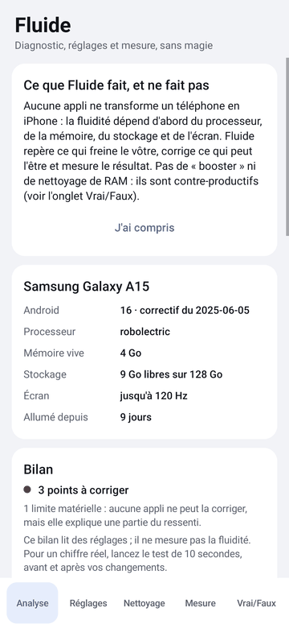
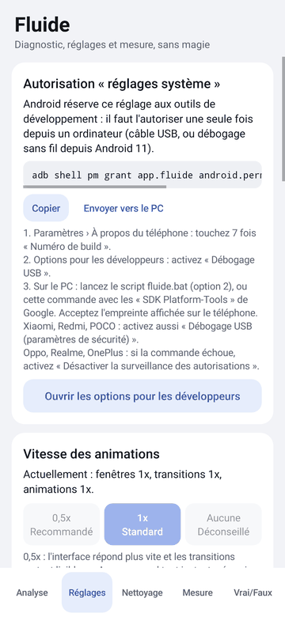
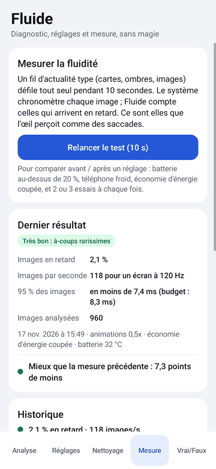
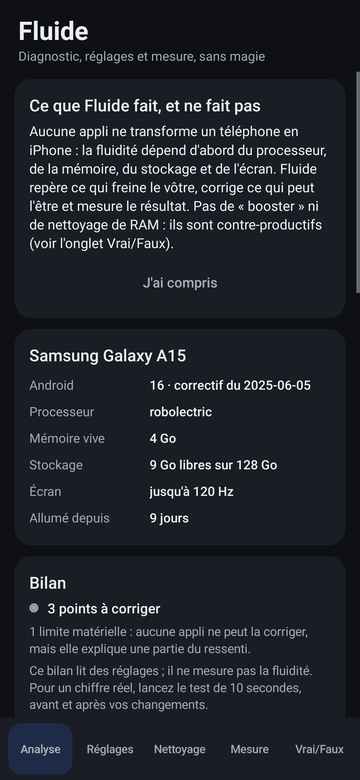

# Fluide : rendre un Android plus réactif, sans magie

Appli Android (APK) + script PC pour diagnostiquer ce qui freine un téléphone, corriger ce qui peut
l'être, et **mesurer** le résultat avant / après.

<p>




</p>

## Ce qu'il faut savoir avant tout

Aucune appli ne rend un Android « aussi fluide qu'un iPhone ». La fluidité dépend d'abord du matériel :
processeur et GPU, quantité de RAM, type de stockage (eMMC lent ou UFS rapide), fréquence de l'écran,
refroidissement. Un iPhone paraît fluide parce qu'Apple conçoit puce, système et écran ensemble et ne
vend pas d'entrée de gamme ; à gamme égale (Pixel, Galaxy S…), l'écart est faible.

Ce qu'un logiciel peut réellement faire :

| Levier | Effet réel | Qui le fait |
|---|---|---|
| Animations à 0,5x | Interface plus **réactive** (on attend moins). Ne rend pas les images plus régulières. | Appli (après autorisation ADB) ou script |
| Fréquence d'écran élevée activée | Défilements plus nets si l'écran fait 90/120 Hz | Réglages Android, ou script (forçage) |
| Compilation ART (`pm art dexopt-packages`, ou `bg-dexopt-job` avant Android 14) | Moins de saccades après une mise à jour d'Android ou des applis | Script |
| Stockage libéré (> 15-20 % libre) | Écritures et mises à jour plus rapides | Appli |
| Applis inutilisées / préinstallées retirées | Moins d'activité de fond et de mémoire occupée | Appli + script |
| Économie d'énergie coupée, téléphone froid | Le processeur n'est plus bridé | Vous (l'appli le détecte) |

Et ce que Fluide **ne fera jamais**, parce que c'est contre-productif : vider la RAM, tuer les tâches,
« booster », vider le cache en permanence (explications dans l'onglet *Vrai/Faux* de l'appli).

## Contenu

| Fichier | Rôle |
|---|---|
| `dist/Fluide-1.1.apk` | L'appli, Android 8.0 et plus (63 Ko, aucune permission Internet) |
| `scripts/fluide.bat` | Script Windows (menu) : les réglages qu'Android réserve à ADB |
| `scripts/fluide.sh` | Même script pour Linux / macOS |
| `app/` | Code source Java, sans aucune bibliothèque |

## Installation (environ 10 minutes)

**Sur le PC**

1. Téléchargez les **SDK Platform-Tools** de Google :
   <https://developer.android.com/tools/releases/platform-tools>, et décompressez-les.
2. Copiez `fluide.bat` (ou `fluide.sh`) **et** `Fluide-1.1.apk` dans le dossier `platform-tools`.

**Sur le téléphone**

3. *Paramètres › À propos du téléphone* : touchez 7 fois *Numéro de build*.
4. *Options pour les développeurs* : activez *Débogage USB*.
   - Xiaomi, Redmi, POCO : activez aussi *Débogage USB (paramètres de sécurité)*.
   - Oppo, Realme, OnePlus : si une commande est refusée, activez *Désactiver la surveillance des autorisations*.
5. Branchez le câble (un câble qui transporte les données, pas seulement la charge) et acceptez
   l'empreinte du PC sur le téléphone.

**Ensuite**

6. Double-cliquez sur `fluide.bat` : option **I** (installer l'appli), puis **A** (tout le recommandé :
   autorisation de l'appli, animations 0,5x, maintenance du stockage, compilation des applis).
7. Ouvrez Fluide sur le téléphone : onglet **Mesure**, puis **Analyse**.

Sans PC : installez l'APK directement sur le téléphone (autorisez l'installation depuis le gestionnaire
de fichiers). Le diagnostic, le nettoyage et la mesure fonctionnent ; seuls les réglages ADB manquent
(les animations se règlent aussi à la main dans les options pour les développeurs).

Si Play Protect affiche un avertissement : l'appli n'étant pas publiée sur le Play Store, il ne la
connaît pas. Le code est ici, et l'appli n'a pas d'accès Internet.

## Le script PC, option par option

| Option | Action | Annulation |
|---|---|---|
| 1 | Diagnostic (lecture seule) | — |
| 2 | Autorise l'appli à régler les animations (`pm grant … WRITE_SECURE_SETTINGS`) | Désinstaller l'appli |
| 3 / 4 | Animations 0,5x / 1x | 4 |
| 5 | Compilation optimisée des applis, 5 à 30 min. Android 14+ : `pm art dexopt-packages`, au premier plan ; si elle est interrompue (« cancelled ») ou refusée, repli automatique sur `compile -m speed-profile -a` | Inutile (le système recompile seul) |
| 6 | Maintenance du stockage (TRIM) | — |
| 7 | Force la fréquence d'écran maximale (coûte de l'autonomie ; sans effet sur Samsung) | 8 (valeurs d'origine sauvegardées) |
| 9 | Désactive des applis préinstallées connues, **une par une avec confirmation** | 10 |
| 11 | Vide le cache de toutes les applis (seulement si le stockage est saturé) | — |
| I / A | Installe l'appli / applique 2 + 3 + 6 + 5 | — |

La liste d'applis préinstallées est volontairement courte (Facebook préinstallé, AppCloud, Samsung Free,
Bixby Voice, Astuces Samsung, AR Doodle, Analytics et MSA Xiaomi, GetApps, Netflix Partner Activation) :
uniquement des applis dont la désactivation est sans risque et réversible. Les applis désactivées sont
notées dans `fluide-applis-desactivees.txt`, à côté du script.

## Mesurer avant / après

L'onglet **Mesure** fait défiler pendant 10 secondes un fil d'actualité type (cartes, ombres, images) et
compte, image par image, celles qui arrivent après leur échéance (`FrameMetrics` ; même définition que
« Janky frames » de `dumpsys gfxinfo`). L'appli est compilée en mode non débogable : elle s'exécute comme
une appli du Play Store, la mesure est donc représentative.

Pour une comparaison honnête :

- mesurez 2 ou 3 fois avant, puis 2 ou 3 fois après : un écart de moins de 2 points est du bruit ;
- mêmes conditions : batterie au-dessus de 20 %, téléphone froid, économie d'énergie coupée ;
- n'attendez pas d'amélioration de ce chiffre en changeant les **animations** : elles changent la
  réactivité ressentie, pas la régularité des images. C'est justement ce que le test permet de vérifier.
  La compilation ART, la chauffe, l'économie d'énergie et la fréquence d'écran, elles, le font bouger.

## Permissions

| Permission | Pourquoi | Comment elle est accordée |
|---|---|---|
| `WRITE_SECURE_SETTINGS` | Régler la vitesse des animations | Une fois, par ADB (option 2) |
| `PACKAGE_USAGE_STATS` | Applis inutilisées et leur taille | *Accès aux données d'utilisation* |
| `QUERY_ALL_PACKAGES` | Voir les applis installées | Automatique |
| `REQUEST_DELETE_PACKAGES` | Ouvrir la fenêtre de désinstallation du système | Automatique (vous confirmez toujours) |
| `MANAGE_EXTERNAL_STORAGE` | Trouver les gros fichiers et APK oubliés | *Accès à tous les fichiers* |

Aucune permission Internet : aucune donnée ne peut sortir du téléphone. Aucun service en arrière-plan.
L'historique des mesures n'est ni sauvegardé dans le cloud ni transféré vers un autre téléphone
(il décrit *ce* matériel).

## Limites connues

- **Testé sans téléphone physique.** L'appli est vérifiée par 47 tests automatiques sur un Android
  simulé (Robolectric, Android 8.0 et Android 16) et par l'analyse statique d'Android (lint, 0 erreur) ;
  le script `.sh` par 63 vérifications contre un téléphone simulé. Le script `.bat` n'a pas pu être
  exécuté sous Windows ici : il est vérifié statiquement (`scripts/test/check-bat.py`) et reprend la
  logique du `.sh`.
- Le forçage de fréquence d'écran utilise les réglages standard d'Android (`peak_refresh_rate`,
  `min_refresh_rate`) ; certaines marques (dont Samsung) les ignorent.
- Le test de fluidité est un scénario type : une appli lourde peut faire moins bien. C'est une
  référence pour comparer votre téléphone à lui-même, pas une note absolue.
- Mise à jour de l'appli : si la nouvelle version est signée avec une autre clé, désinstallez l'ancienne
  puis refaites l'option 2.

## Développement

```bash
./gradlew assembleRelease        # JDK 17+, Android SDK 36 ; signature via keystore.properties (non versionné)
./gradlew testDebugUnitTest      # 47 tests ; captures d'écran dans build/screenshots/
./gradlew lintRelease
bash scripts/test/test-fluide-sh.sh
python3 scripts/test/check-bat.py scripts/fluide.bat
```

`keystore.properties` (ignoré par git) : `storeFile`, `storePassword`, `keyAlias`, `keyPassword`.
Sans ce fichier, la version release est signée avec la clé de débogage locale (elle reste non débogable).
Ne publiez jamais la clé de signature : une mise à jour signée avec elle hériterait de la permission
`WRITE_SECURE_SETTINGS` accordée à l'appli.
