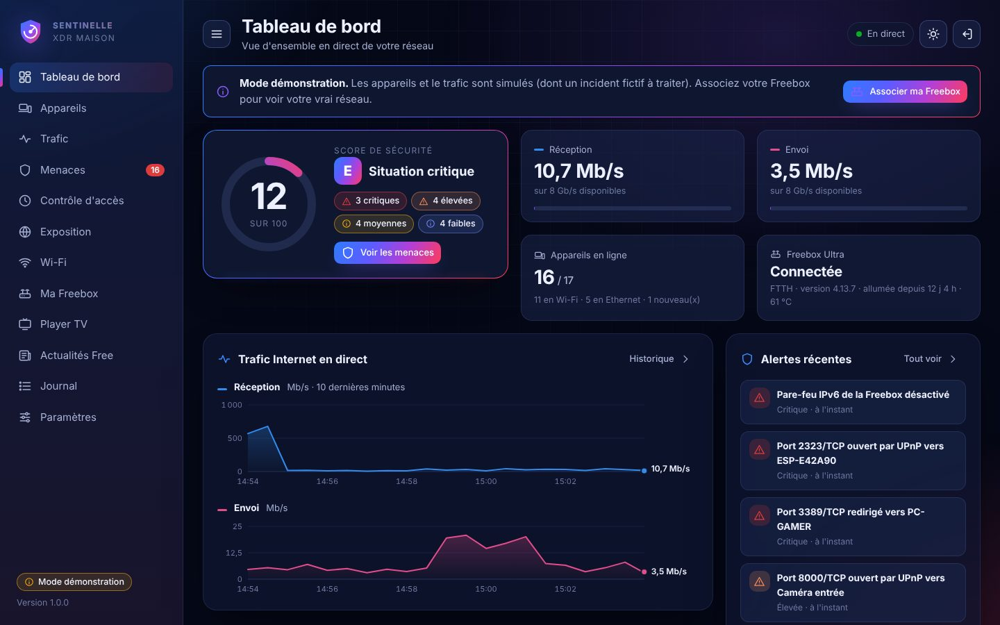
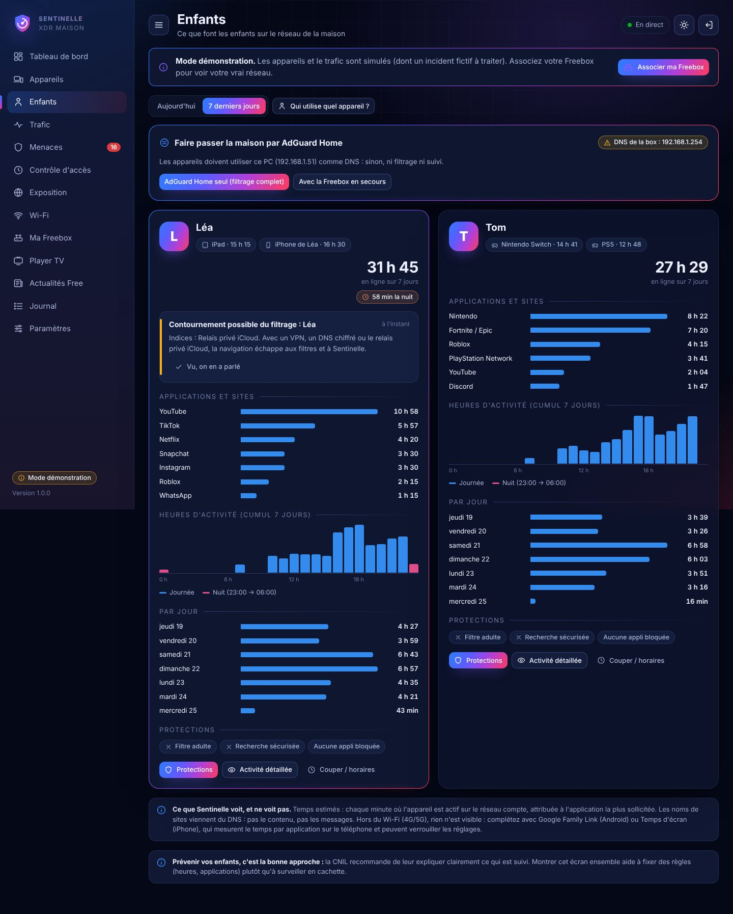

# Sentinelle XDR — la console de sécurité de la maison

Tableau de bord **local** pour surveiller et protéger le réseau d'une **Freebox** (pensé pour la Freebox Ultra), à installer sur un **PC Windows 11 Pro avec IIS et PHP** (8.1 à 8.5). Aucune donnée ne part dans un cloud. L'interface est en français, avec un thème sombre en dégradé bleu → rouge, et s'utilise aussi sur téléphone.



> **Démonstration intégrée.** Tant que la Freebox n'est pas associée, Sentinelle tourne sur une Freebox **simulée** (17 appareils, trafic vivant, Player TV) avec un **incident fictif** à traiter : un module Wi-Fi inconnu ouvre un port telnet par UPnP, usurpe une adresse IP et contacte des domaines malveillants. Vous pouvez tout essayer sans rien risquer.

---

## Ce que fait Sentinelle

| Onglet | Ce que vous voyez et pouvez faire |
|---|---|
| **Tableau de bord** | Score de sécurité (A à E), débits Internet en direct, alertes récentes, tous les appareils avec leur icône, leur IP, leur connexion (Wi-Fi 2,4/5/6 GHz et signal, ou prise Ethernet), leurs débits et « ce qu'ils font en ce moment » (services détectés par DNS). |
| **Appareils** | Recherche et filtres (en ligne, Wi-Fi, Ethernet, nouveaux, coupés). Fiche complète par appareil : adresses, fabricant, profil, historique de trafic sur 6 h, journal, domaines consultés. **Actions** : couper Internet (30 min, 1 h, 2 h, 8 h ou jusqu'à nouvel ordre), rétablir, **isoler**, réveiller (Wake-on-LAN), renommer, marquer comme connu ou inconnu. |
| **Enfants** | Pour chaque enfant (ses appareils regroupés) : **temps passé par application ou site**, **heures d'activité** (la nuit en évidence), détail jour par jour, dernières activités, alertes (activité la nuit, **contournement du filtrage** par VPN, DNS chiffré ou relais privé iCloud, site adulte bloqué). **Protections** par enfant : filtre adulte, recherche sécurisée et mode restreint YouTube, **applications bloquées** (TikTok, Snapchat, Fortnite…). Rapport de la semaine sur le téléphone. |
| **Trafic** | Historique sur 1 h, 24 h ou 7 jours (statistiques de la box), appareils les plus actifs, vue en tableau. |
| **Menaces** | Alertes expliquées en clair, avec la référence **MITRE ATT&CK** quand elle existe et une **correction en un clic** quand la box le permet. Vous pouvez aussi « accepter le risque », pour éviter de crouler sous les alertes. |
| **Contrôle d'accès** | Profils Freebox (un profil = les appareils d'une personne) : coupure immédiate ou minutée, **horaires** (ex. « 21 h 30 → 7 h, du dimanche au jeudi ») et semaine type visuelle. |
| **Exposition** | Tout ce qui est ouvert sur Internet : **pare-feu IPv6**, redirections de ports (avec niveau de risque), **UPnP** et ses ouvertures, DMZ, accès distant à Freebox OS, FTP, partage Windows. |
| **Wi-Fi** | Réseaux, chiffrement (WPA2, WPA3), canaux, filtrage par adresse MAC (liste noire ou liste blanche). La clé Wi-Fi n'est jamais affichée. |
| **Ma Freebox** | Modèle, version de Freebox OS, connexion fibre (puissance optique), IP publiques, DHCP, prises Ethernet, températures, redémarrage. **Mises à jour** : votre version comparée aux versions annoncées dans l'actualité. |
| **Player TV** | État (allumé ou en veille), chaîne ou application en cours, volume, connexion, actualités du Player. |
| **Actualités Free** | Univers Freebox et Freenews, rangés par thème (mises à jour, Freebox, Player, Free Mobile, sécurité…). |
| **Journal** | Événements du réseau (connexions, nouveaux appareils, coupures) et **audit** de toutes les actions et connexions à la console. |
| **Paramètres** | Association de la Freebox et droits accordés, mot de passe, **double authentification (TOTP)**, seuils de détection, AdGuard Home, notifications sur téléphone, sources d'actualités, tâche planifiée, diagnostic de l'installation. |

**Détections incluses** : pare-feu IPv6 coupé · DMZ · UPnP et ports ouverts par UPnP · redirections dangereuses (RDP, SMB, Telnet, VNC, bases de données…) · administration de la box ouverte sur Internet · FTP distant ou anonyme · partage de la box sans mot de passe · Wi-Fi WEP/TKIP · WPS · **nouvel appareil** · **adresse IP revendiquée par deux appareils** (usurpation ARP) · **envoi massif inhabituel** (fuite de données ou botnet) · domaine malveillant · minage de cryptomonnaie · rafales de domaines inexistants (logiciel malveillant qui génère des adresses, DGA) · console Sentinelle en HTTP · surveillance continue arrêtée · tentatives répétées de connexion.

---

## Ce que Sentinelle ne fait pas (à lire)

- **Ce n'est pas un XDR d'entreprise.** Un vrai XDR (CrowdStrike, SentinelOne, Microsoft Defender XDR…) installe un agent sur chaque ordinateur et voit les processus, les fichiers, les comptes. Sentinelle observe le **réseau** à travers la Freebox (et le DNS, si vous ajoutez AdGuard Home). C'est une console de détection et de réponse **réseau** pour la maison. Pour l'équivalent libre d'un XDR avec agents, regardez **Wazuh**.
- **Sentinelle ne voit pas le contenu** de la navigation (HTTPS). Avec AdGuard Home, elle voit les **noms de domaine** demandés. Un appareil qui utilise un DNS chiffré (DoH), un VPN ou le relais privé iCloud échappe à cette vue.
- **Couper Internet ≠ isoler du réseau local.** La Freebox coupe l'accès Internet d'un profil, mais l'appareil continue de parler aux autres appareils de la maison. Pour le Wi-Fi, Sentinelle ajoute un refus par adresse MAC, ce qui le sort du réseau. Pour un appareil **filaire**, il faut **débrancher le câble**, car la Freebox ne sait pas séparer un appareil filaire du reste du réseau (pas de VLAN).
- **Les horaires dépendent du PC serveur** au moment de la coupure : s'il est éteint à 21 h 30, la coupure n'a pas lieu. La fin de coupure, elle, est gérée par la box elle-même. Pour une garantie totale, doublez avec la planification de Freebox OS.
- **« Mises à jour à venir »** : Free ne publie pas de calendrier. Sentinelle repère les versions annoncées dans l'actualité et les compare à la vôtre. C'est une estimation, pas une information officielle.
- **Images des appareils** : Sentinelle affiche une icône selon le type et le fabricant détectés, pas une photo. Elle ne peut pas savoir à quoi ressemble votre appareil.
- **Légalité** : surveiller à son insu la navigation d'un adulte (conjoint compris) peut constituer un délit (articles 226-1 et 226-15 du Code pénal ; peines aggravées entre conjoints). Prévenez les personnes du foyer. Pour un enfant mineur, le contrôle parental est légitime : la CNIL recommande de l'en informer clairement.

---

## Installation sur Windows 11 Pro (IIS + PHP)

Prérequis : IIS et PHP déjà installés (votre `Installer-IIS-PHP.cmd`), PC relié à la Freebox, de préférence **en Ethernet**.

1. Copiez le dossier `xdr` sur le PC serveur (n'importe où, par exemple sur le Bureau).
2. Double-cliquez sur **`xdr\tools\Installer-XDR.cmd`** et acceptez la demande d'administrateur. Le script :
   - active dans `php.ini` les extensions `curl`, `pdo_sqlite`, `sqlite3`, `openssl` et `mbstring`, et installe les certificats racines (`cacert.pem`), avec une sauvegarde `php.ini.avant-sentinelle` ;
   - copie Sentinelle dans `C:\inetpub\wwwroot\xdr`, sans écraser vos données lors d'une mise à jour ;
   - donne à IIS le droit d'écrire dans `xdr\data` ;
   - crée la tâche planifiée **« Sentinelle XDR »** (une analyse par minute) ;
   - repère les règles du pare-feu Windows qui ouvrent IIS à **tout Internet** (IPv6 compris) et propose de les limiter au réseau local ;
   - propose d'installer **AdGuard Home**, indispensable pour voir les applications utilisées par les enfants ;
   - ouvre `http://localhost/xdr/`.
3. **Choisissez le mot de passe** (10 caractères minimum, une phrase de passe est idéale). Pour la sécurité, cette première étape n'est possible **que depuis le PC serveur lui-même**.
4. Explorez la démonstration, puis passez à « Associer ma Freebox » ci-dessous.

Ensuite, depuis n'importe quel appareil de la maison : `http://NOM-DU-PC/xdr/`.

> Le script PowerShell n'a pas pu être exécuté sur un vrai Windows pendant le développement (aucun Windows disponible). S'il bloque à une étape, le message indique laquelle : faites-la à la main (section suivante).

### Installation manuelle (si le script échoue)

1. **php.ini** (dans le dossier de PHP) : retirez le `;` devant `extension=curl`, `extension=pdo_sqlite`, `extension=sqlite3`, `extension=openssl`, `extension=mbstring`. Téléchargez `https://curl.se/ca/cacert.pem` dans le dossier de PHP et ajoutez `curl.cainfo = "C:\PHP\cacert.pem"` (adaptez le chemin). Puis lancez `iisreset` dans une invite de commandes administrateur.
2. Copiez le dossier `xdr` dans `C:\inetpub\wwwroot\`.
3. Droits d'écriture : clic droit sur `C:\inetpub\wwwroot\xdr\data` › Propriétés › Sécurité › Modifier › Ajouter `IIS_IUSRS` puis `IUSR`, cochez **Modification** pour les deux (créez le dossier `data` s'il n'existe pas). Ou en invite de commandes administrateur :

```bash
icacls C:\inetpub\wwwroot\xdr\data /grant "*S-1-5-32-568:(OI)(CI)M" "*S-1-5-17:(OI)(CI)M" /T
```

4. Tâche planifiée : ouvrez Sentinelle › Paramètres › **Surveillance continue**. La commande exacte, avec votre clé, y est affichée. Copiez-la dans une invite de commandes administrateur.
5. Pare-feu Windows : ne laissez jamais une règle HTTP/HTTPS entrante ouverte à « Toute adresse ». Limitez-la au **sous-réseau local** (Pare-feu Windows Defender › Règles de trafic entrant › la règle › Étendue › Adresse IP distante : « Sous-réseau local »).

### HTTPS pour la console (recommandé)

Sans HTTPS, le mot de passe Sentinelle circule en clair sur votre réseau. Dans le Gestionnaire IIS : serveur › **Certificats de serveur** › *Créer un certificat auto-signé*. Puis site › **Liaisons** › Ajouter › type `https`, port 443, ce certificat. Le navigateur affichera un avertissement la première fois (certificat non reconnu) : c'est normal sur un réseau privé. Gardez la liaison `http` sur 127.0.0.1 pour la tâche planifiée, ou adaptez sa commande.

---

## Associer la Freebox

1. Paramètres › **Freebox** › **Associer ma Freebox**.
2. Allez devant la Freebox (le boîtier Server) : l'écran affiche une demande « Sentinelle XDR ». **Appuyez sur la flèche droite** pour accepter (vous avez environ 2 minutes).
3. **Accordez les droits**, faute de quoi la plupart des actions répondront « droit manquant » : ouvrez Freebox OS (`http://mafreebox.freebox.fr`) › Paramètres de la Freebox › **Gestion des accès** › onglet **Applications** › « Sentinelle XDR » › crayon, puis cochez :
   - « Modification des réglages de la Freebox » ;
   - « Accès au contrôle parental » ;
   - « Gestion des profils utilisateur » ;
   - « Contrôle du Freebox Player ».
4. **Fermez la porte** : Gestion des accès › Paramètres › décochez « Permettre les nouvelles demandes d'association ».
5. Dans Paramètres, la liste « Droits accordés à Sentinelle » doit afficher une coche pour chacun.

Par défaut, Sentinelle parle à la box en **HTTPS** (`https://mafreebox.freebox.fr`), en vérifiant le certificat avec les autorités Freebox fournies dans `certs/`. Elle bascule en HTTP local seulement si le HTTPS échoue (option désactivable).

### Créer les profils (pour couper Internet)

La Freebox coupe Internet **par profil**. Créez vos profils dans Freebox OS (Contrôle parental › Profils) et rangez-y les appareils de chacun. Si vous coupez un appareil qui n'a pas de profil, ou qui partage un profil, Sentinelle propose de lui créer un **profil dédié** sur la box.

---

## Suivre ce que font les enfants



1. **Dites à Sentinelle quels appareils sont ceux des enfants** : onglet **Enfants** › « Qui utilise quel appareil ? », ou bouton « À qui ? » dans la fiche d'un appareil. Les appareils d'un même enfant sont regroupés.
2. **Installez AdGuard Home** sur le PC serveur (proposé par `Installer-XDR.cmd`, ou à la main ci-dessous). Sans lui, Sentinelle mesure seulement les heures où chaque appareil est actif, pas les applications.
3. Onglet **Enfants** › « Faire passer la maison par AdGuard Home » : Sentinelle indique à la Freebox de distribuer ce PC comme serveur DNS. Deux choix :
   - **AdGuard seul** : tout passe par le filtre, mais si le PC est éteint, Internet semble en panne pour toute la maison ;
   - **avec la Freebox en secours** : Internet marche toujours, mais certains appareils passent parfois par le secours, sans filtre.
4. Pour chaque enfant, ouvrez **Protections** : filtre adulte, recherche sécurisée, applications bloquées.
5. Paramètres › **Enfants** : heures de nuit, alertes sur le téléphone, rapport du dimanche soir.

**Bon à savoir**
- Les **temps sont estimés** : chaque minute où l'appareil est actif sur le réseau compte, attribuée à l'application la plus sollicitée des 5 dernières minutes. C'est fiable pour repérer les tendances (« 3 h de TikTok mardi », « actif à 1 h du matin »), pas au chronomètre près.
- **En 4G/5G, hors du Wi-Fi, rien n'est visible.** Pour le téléphone d'un enfant, ajoutez **Google Family Link** (Android) ou **Temps d'écran** (iPhone). Ils mesurent le temps par application sur l'appareil lui-même et peuvent **verrouiller** les réglages de contournement (VPN, DNS privé, relais privé iCloud).
- Sentinelle voit les **noms de sites et d'applications**, jamais le contenu (messages, vidéos regardées, recherches).
- Vous prévenez vos enfants : c'est ce que recommande la CNIL, et c'est aussi le plus efficace. Montrer cet écran ensemble aide à fixer des règles.

### Installer AdGuard Home à la main

1. Téléchargez `AdGuardHome_windows_amd64.zip` (site officiel ou GitHub d'AdGuard), décompressez-le dans `C:\Program Files\AdGuardHome`.
2. Invite de commandes **administrateur** :

```bash
"C:\Program Files\AdGuardHome\AdGuardHome.exe" -s install
```

3. Ouvrez `http://127.0.0.1:3000`. Dans l'assistant, choisissez le **port 3000** pour l'interface d'administration (IIS occupe déjà le port 80), gardez le port 53 pour le DNS, et créez un identifiant.
4. Pare-feu Windows : autorisez le port 53 (UDP et TCP) en entrée, pour le **sous-réseau local** seulement.
5. Sentinelle › Paramètres › **Navigation (DNS)** : cochez « Utiliser AdGuard Home », adresse `http://127.0.0.1:3000`, identifiant, puis **Tester**.

AdGuard Home apporte aussi « ce qu'ils font en ce moment » sur le tableau de bord, l'onglet Activité de chaque appareil, la détection des domaines malveillants, du minage et des DGA, et le refus du DNS pour un appareil isolé. Il bloque en plus les publicités et les sites malveillants pour toute la maison.

## Notifications sur le téléphone (facultatif)

Paramètres › **Notifications**. Le plus simple : l'application gratuite **ntfy** (Android/iOS). Abonnez-vous à un sujet au nom **long et imprévisible** (sur ntfy.sh, quiconque connaît le nom peut lire le sujet), puis indiquez `https://ntfy.sh/votre-sujet`. Telegram, Discord, Gotify et webhook JSON sont aussi pris en charge.

---

## Sécurité de Sentinelle elle-même

Sentinelle a les clés de votre réseau : elle est conçue comme une cible.

- **Réseau local uniquement** : toute adresse hors des plages privées est refusée. En IPv6, seul votre propre préfixe /64 est accepté. **N'ouvrez jamais de redirection de port vers Sentinelle** : depuis l'extérieur, passez par le VPN WireGuard de la Freebox.
- **Première mise en service seulement depuis le serveur** (`localhost`).
- Mot de passe haché (`password_hash`), règles de complexité, **blocage après 5 erreurs** (15 min), **double authentification TOTP** avec 8 codes de secours.
- Session courte (30 min d'inactivité, 12 h au maximum), cookie `HttpOnly` + `SameSite=Strict`. Changer le mot de passe déconnecte les autres sessions.
- **Jeton anti-CSRF** sur chaque action, contrôle de l'origine de la requête.
- **Politique de sécurité du contenu (CSP) stricte** : aucun script externe ni en ligne. Les noms d'appareils (qu'un appareil malveillant peut choisir, par exemple ``) et les articles RSS sont toujours insérés comme du texte.
- Mot de passe redemandé pour les actions sensibles (redémarrage de la box, dissociation, double authentification).
- **Journal d'audit** de chaque action et connexion. La clé Wi-Fi n'est jamais envoyée au navigateur.
- `app`, `data`, `config`, `tools`, `certs` et `docs` sont masqués par le `web.config` (et par le `.htaccess` sous Apache). Pour aller plus loin, placez `data` **hors du site** (`config/config.sample.php` › `data_dir`).
- Sauvegardez le dossier `data` : il contient la clé d'accès à votre Freebox (`freebox.json`). Traitez-le comme un trousseau de clés.

## Mise à jour de Sentinelle

Relancez `tools\Installer-XDR.cmd` depuis la nouvelle version : les fichiers sont remplacés, et `data` comme `config\config.php` sont conservés.

## Dépannage

| Symptôme | Solution |
|---|---|
| « Réponse illisible du serveur » | PHP ne s'exécute pas dans IIS : vérifiez le mappage de gestionnaire `*.php` (FastCGI). Ouvrez `http://localhost/xdr/api.php?action=session`, qui doit afficher du JSON. |
| « pdo_sqlite n'est pas activée » | `php.ini` : `extension=pdo_sqlite` et `extension=sqlite3`, puis `iisreset`. |
| « Le dossier de données n'est pas accessible en écriture » | Droits « Modification » pour `IIS_IUSRS` et `IUSR` sur `xdr\data` (voir l'installation manuelle). |
| « Aucune Freebox trouvée » | Le PC doit être sur le réseau de la box. Essayez l'adresse `http://192.168.1.254` dans Paramètres › Freebox. |
| « Droit manquant » | Gestion des accès › Applications › Sentinelle XDR : cochez les droits listés plus haut. |
| « Nouvelles associations désactivées » | Réactivez-les le temps d'associer Sentinelle, puis désactivez-les à nouveau. |
| Actualités indisponibles | PHP ne connaît pas les autorités de certification : `curl.cainfo` dans `php.ini` (voir l'installation manuelle). |
| Mot de passe perdu | Sur le serveur : `php C:\inetpub\wwwroot\xdr\tools\setup.php --password` |
| Téléphone (double authentification) perdu | Utilisez un code de secours, ou sur le serveur : `php …\tools\setup.php --reset-2fa` |
| La surveillance continue reste « inactive » | Planificateur de tâches › « Sentinelle XDR » › Historique. Testez la commande de Paramètres › Surveillance continue à la main. |

Paramètres › **Diagnostic** vérifie automatiquement PHP, les extensions, les droits, HTTPS et la tâche planifiée.

---

## Ce qui a été vérifié, et ce qui reste à valider sur votre box

**Testé** (PHP 8.3, Chromium) : toutes les actions de l'API contre la Freebox simulée (mise en service, connexion, CSRF, double authentification et codes de secours, blocage des essais, coupure par profil partagé ou dédié, isolement et retour arrière, corrections en un clic, horaires, filtrage Wi-Fi, renommage, redémarrage, onglet Enfants : temps par application, protections, bascule du DNS de la box) ; l'interface sur ordinateur et téléphone, en thème sombre et clair, sans aucune erreur et sous CSP stricte ; la lecture des vrais flux RSS d'Univers Freebox et de Freenews.

**Construit d'après la documentation et des projets publiés, à confirmer sur votre Freebox Ultra** : l'API Freebox OS (authentification, réseau, Wi-Fi, ports, UPnP, IPv6, système, Player) suit la bibliothèque de référence `freebox-api` et les définitions de types publiées. Le contrôle d'accès par profil (`network_control`) n'est pas documenté officiellement : il suit deux intégrations Home Assistant qui fonctionnent sur Freebox Ultra (`PUT` avec l'objet complet). La **création** d'un profil dédié (`POST profile/`) n'a pas d'exemple public : si elle échoue, créez le profil dans Freebox OS, le message vous y invite. Après chaque modification, Sentinelle relit la box pour vérifier que le changement a bien été appliqué, et le signale sinon. Les protections par enfant utilisent l'API officielle d'AdGuard Home (clients et services bloqués), testée ici contre une simulation : à confirmer avec votre installation.

Les sources sont dans [`docs/RECHERCHE.md`](docs/RECHERCHE.md).

## Arborescence

```
xdr/
├─ index.html            interface (une seule page)
├─ api.php               API JSON (point d'entrée unique, sessions, CSRF, audit)
├─ web.config / .htaccess  masquage des dossiers internes, en-têtes de sécurité
├─ assets/               app.js (interface), app.css (thème), favicon.svg
├─ app/                  moteur PHP : Freebox.php (API Freebox), DemoBox.php (box simulée), Kids.php (enfants),
│                        Network.php (appareils, actions), Detect.php (détections, score),
│                        Collector.php (collecte), Schedules.php, Dns.php (AdGuard Home),
│                        News.php (actualités), Notify.php, Auth.php, Db.php (SQLite), Http.php
├─ certs/freebox-ca.pem  autorités de certification Freebox (connexion HTTPS vérifiée)
├─ config/               config.sample.php (réglages de sécurité figés)
├─ tools/                Installer-XDR.cmd/.ps1, setup.php, collect.php
├─ docs/                 RECHERCHE.md, captures
└─ data/                 créé au premier lancement : base SQLite, sessions, clé Freebox
```
