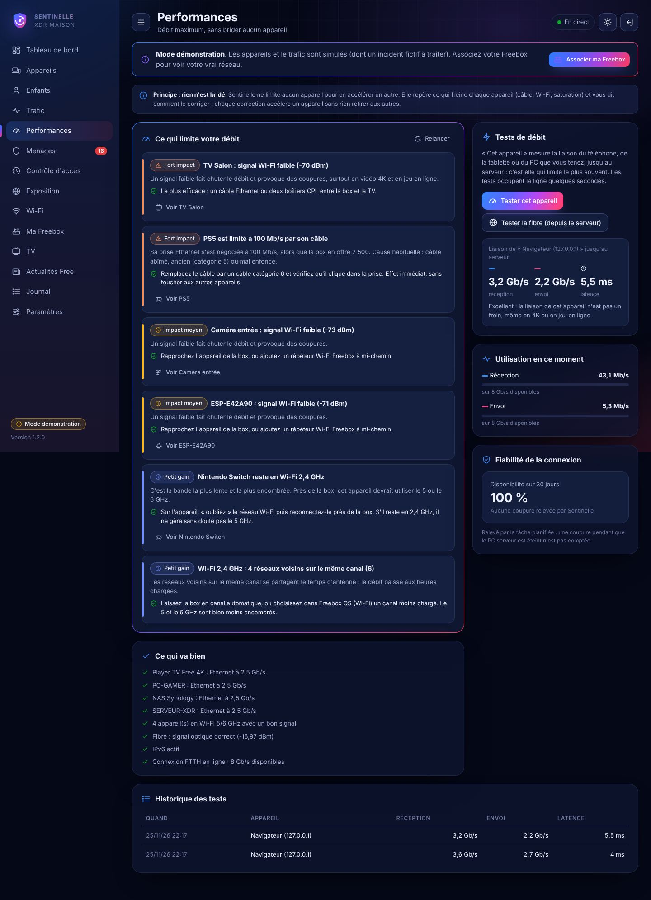
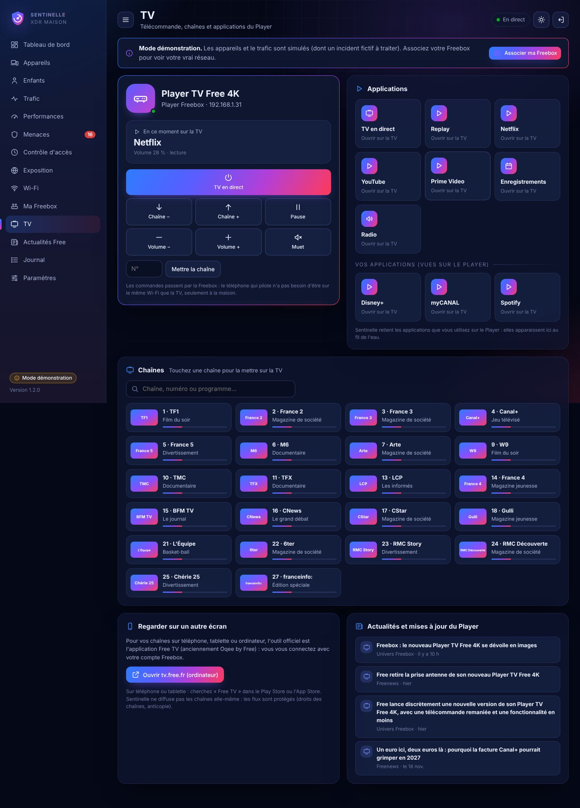

# Sentinelle XDR — la console de sécurité de la maison

Tableau de bord **local** pour surveiller et protéger le réseau d'une **Freebox** (pensé pour la Freebox Ultra), à installer sur un **PC Windows 11 Pro avec IIS et PHP** (8.1 à 8.5). Aucune donnée ne part dans un cloud. L'interface est en français, avec un thème sombre en dégradé bleu → rouge, et s'utilise aussi sur téléphone.


> **Démonstration intégrée.** Tant que la Freebox n'est pas associée, Sentinelle tourne sur une Freebox **simulée** (17 appareils, trafic vivant, Player TV) avec un **incident fictif** à traiter : un module Wi-Fi inconnu ouvre un port telnet par UPnP, usurpe une adresse IP et contacte des domaines malveillants. Vous pouvez tout essayer sans rien risquer.

---

## Ce que fait Sentinelle

| Onglet | Ce que vous voyez et pouvez faire |
|---|---|
| **Tableau de bord** | Score de sécurité (A à E), débits Internet en direct, alertes récentes, tous les appareils avec leur icône, leur IP, leur connexion (Wi-Fi 2,4/5/6 GHz et signal, ou prise Ethernet), leurs débits et « ce qu'ils font en ce moment » (services détectés par DNS). |
| **Appareils** | Recherche et filtres (en ligne, Wi-Fi, Ethernet, nouveaux, coupés). Fiche complète par appareil : adresses, fabricant, profil, historique de trafic sur 6 h, journal, domaines consultés. **Actions** : couper Internet (30 min, 1 h, 2 h, 8 h ou jusqu'à nouvel ordre), rétablir, **isoler**, réveiller (Wake-on-LAN), renommer, marquer comme connu ou inconnu. |
| **Enfants** | Pour chaque enfant (ses appareils regroupés) : **temps passé par application ou site**, **heures d'activité** (la nuit en évidence), détail jour par jour, dernières activités, alertes (activité la nuit, **contournement du filtrage** par VPN, DNS chiffré ou relais privé iCloud, site adulte bloqué). **Protections** par enfant : filtre adulte, recherche sécurisée et mode restreint YouTube, **applications bloquées** (TikTok, Snapchat, Fortnite…). Rapport de la semaine sur le téléphone. |
| **Trafic** | Historique sur 1 h, 24 h ou 7 jours (statistiques de la box), appareils les plus actifs, vue en tableau. |
| **Performances** | **Ce qui freine chaque appareil**, classé par impact, avec la correction : câble limité à 100 Mb/s, signal Wi-Fi faible, appareil resté en 2,4 GHz, canal encombré par les voisins, ligne saturée, fibre hors tolérance, box trop chaude. **Tests de débit** : « cet appareil » (téléphone, tablette ou PC que vous tenez, jusqu'au serveur) et « la fibre » (depuis le serveur). Disponibilité de la connexion et coupures relevées. **Rien n'est bridé** : aucun appareil n'est ralenti pour en accélérer un autre. |
| **Menaces** | Alertes expliquées en clair, avec la référence **MITRE ATT&CK** quand elle existe et une **correction en un clic** quand la box le permet. Vous pouvez aussi « accepter le risque », pour éviter de crouler sous les alertes. |
| **Contrôle d'accès** | Profils Freebox (un profil = les appareils d'une personne) : coupure immédiate ou minutée, **horaires** (ex. « 21 h 30 → 7 h, du dimanche au jeudi ») et semaine type visuelle. |
| **Exposition** | Tout ce qui est ouvert sur Internet : **pare-feu IPv6**, redirections de ports (avec niveau de risque), **UPnP** et ses ouvertures, DMZ, accès distant à Freebox OS, FTP, partage Windows. |
| **Wi-Fi** | Réseaux, chiffrement (WPA2, WPA3), canaux, filtrage par adresse MAC (liste noire ou liste blanche). La clé Wi-Fi n'est jamais affichée. |
| **Ma Freebox** | Modèle, version de Freebox OS, connexion fibre (puissance optique), IP publiques, DHCP, prises Ethernet, températures, redémarrage. **Mises à jour** : votre version comparée aux versions annoncées dans l'actualité. |
| **TV** | **Télécommande** du Player (allumer, chaînes, volume, muet, pause, numéro de chaîne), **chaînes** avec logo et programme en cours (touchez-en une pour la mettre sur la TV), **applications** (TV en direct, Replay, Netflix, YouTube, Prime Video, enregistrements, radio, et celles que vous utilisez sur le Player), actualités du Player. |
| **Actualités Free** | Univers Freebox et Freenews, rangés par thème (mises à jour, Freebox, Player, Free Mobile, sécurité…). |
| **Journal** | Événements du réseau (connexions, nouveaux appareils, coupures) et **audit** de toutes les actions et connexions à la console. |
| **Paramètres** | Association de la Freebox et droits accordés, mot de passe, **double authentification (TOTP)**, seuils de détection, AdGuard Home, notifications sur téléphone, sources d'actualités, tâche planifiée, diagnostic de l'installation. |

**Détections incluses** : pare-feu IPv6 coupé · DMZ · UPnP et ports ouverts par UPnP · redirections dangereuses (RDP, SMB, Telnet, VNC, bases de données…) · administration de la box ouverte sur Internet · FTP distant ou anonyme · partage de la box sans mot de passe · Wi-Fi WEP/TKIP · WPS · **nouvel appareil** · **adresse IP revendiquée par deux appareils** (usurpation ARP) · **envoi massif inhabituel** (fuite de données ou botnet) · domaine malveillant · minage de cryptomonnaie · rafales de domaines inexistants (logiciel malveillant qui génère des adresses, DGA) · console Sentinelle en HTTP · surveillance continue arrêtée · tentatives répétées de connexion.

---

## Ce que Sentinelle ne fait pas (à lire)

- **Ce n'est pas un XDR d'entreprise.** Un vrai XDR (CrowdStrike, SentinelOne, Microsoft Defender XDR…) installe un agent sur chaque ordinateur et voit les processus, les fichiers, les comptes. Sentinelle observe le **réseau** à travers la Freebox (et le DNS, si vous ajoutez AdGuard Home). C'est une console de détection et de réponse **réseau** pour la maison. Pour l'équivalent libre d'un XDR avec agents, regardez **Wazuh**.
- **Sentinelle ne voit pas le contenu** de la navigation (HTTPS). Avec AdGuard Home, elle voit les **noms de domaine** demandés. Un appareil qui utilise un DNS chiffré (DoH), un VPN ou le relais privé iCloud échappe à cette vue.
- **Couper Internet ≠ isoler du réseau local.** La Freebox coupe l'accès Internet d'un profil, mais l'appareil continue de parler aux autres appareils de la maison. Pour le Wi-Fi, Sentinelle ajoute un refus par adresse MAC, ce qui le sort du réseau. Pour un appareil **filaire**, il faut **débrancher le câble**, car la Freebox ne sait pas séparer un appareil filaire du reste du réseau (pas de VLAN).
- **Les horaires dépendent du PC serveur** au moment de la coupure : s'il est éteint à 21 h 30, la coupure n'a pas lieu. La fin de coupure, elle, est gérée par la box elle-même. Pour une garantie totale, doublez avec la planification de Freebox OS.
- **« Mises à jour à venir »** : Free ne publie pas de calendrier. Sentinelle repère les versions annoncées dans l'actualité et les compare à la vôtre. C'est une estimation, pas une information officielle.
- **Images des appareils** : Sentinelle affiche une icône selon le type et le fabricant détectés, pas une photo. Elle ne peut pas savoir à quoi ressemble votre appareil.
- **Légalité** : surveiller à son insu la navigation d'un adulte (conjoint compris) peut constituer un délit (articles 226-1 et 226-15 du Code pénal ; peines aggravées entre conjoints). Prévenez les personnes du foyer. Pour un enfant mineur, le contrôle parental est légitime : la CNIL recommande de l'en informer clairement.

---

## Installation sur Windows 11 Pro (IIS + PHP)

Prérequis : le PC serveur préparé avec le tutoriel « Serveur web IIS + PHP sur Windows 11 Pro » (`Installer-IIS-PHP.cmd` : IIS avec CGI, PHP 8.5 dans `C:\PHP`), relié à la Freebox, de préférence **en Ethernet**.

1. **Avant d'extraire, débloquez le ZIP** : clic droit sur le fichier › Propriétés › cochez **Débloquer** › OK. Puis clic droit › **Extraire tout**.
2. Double-cliquez sur **`INSTALLER.cmd`** et acceptez la demande d'administrateur. Si Windows affiche « Windows a protégé votre ordinateur » : *Informations complémentaires* › *Exécuter quand même*.
3. Le script **analyse d'abord, sans rien modifier**, puis affiche les changements prévus (`[à faire]`). Tapez **O** puis Entrée pour les appliquer.
4. À la fin, il donne les adresses à ouvrir. **Sur le PC serveur**, ouvrez `http://localhost/xdr/` et choisissez le mot de passe (10 caractères minimum). Pour la sécurité, cette première étape n'est possible que depuis le serveur lui-même.
5. Explorez la démonstration, puis passez à « Associer la Freebox » ci-dessous.

Ensuite, depuis n'importe quel appareil de la maison : `http://ADRESSE-DU-PC/xdr/` (adresse affichée à la fin de l'installation).

**Ce que fait le script.** Il reprend les leçons des installations déjà faites sur ce serveur (tutoriel IIS + PHP, Boussole, Missions) :

| Étape | Détail |
|---|---|
| Vérifications | IIS avec CGI/FastCGI, site « Default Web Site », PHP 8.1 ou plus et ses dépendances (Visual C++), branchement des `.php` sur PHP, `php.ini` (y compris le chemin entre guillemets que renvoie PHP 8.5) |
| `php.ini` | seulement si besoin, **après une copie** (`php.ini.avant-sentinelle-…`) : extensions `pdo_sqlite`, `curl`, `mbstring` ; PHP 8.5 : ligne `zend_extension=opcache` mise en commentaire et `register_argc_argv = Off` ; `open_basedir` complétée si vous l'utilisez. Votre fichier n'est pas réécrit : seules ces lignes changent |
| Application IIS | `/xdr` devient une **application à part**, dans son propre pool **« SentinelleXDR »**. Les visiteurs anonymes tournent sous l'identité de ce pool (avec `fastcgi.impersonate = 1`, PHP écrirait sinon sous `IUSR`) |
| Données | **`C:\SentinelleDonnees`, hors du site**, accessible au **seul pool de Sentinelle**, au système et aux administrateurs : aucune autre application du serveur ne peut lire la clé d'accès à votre Freebox. Une installation précédente (dossier `data` dans le site) y est déplacée |
| Copie | fichiers de l'application dans `C:\inetpub\wwwroot\xdr` ; jamais `config\config.php` ni les données. Seul le pool de Sentinelle est arrêté pendant la copie : vos autres applications continuent |
| Contrôle | l'API répond, tourne dans son pool, **écrit** ses données, et le code, les réglages et les certificats sont **invisibles depuis un navigateur**. En cas d'erreur IIS (500.19, 404.3, 500.21, 401.3, 503…), le script donne la cause probable |
| Tâche planifiée | « Sentinelle XDR » : une analyse par minute, lancée une première fois pour vérifier qu'elle marche |
| Réseau | profil Public › Privé ; règles du pare-feu qui ouvrent les ports 80/443 à **tout Internet** limitées au réseau de la maison et aux VPN (Freebox, Tailscale) |
| AdGuard Home | proposé (question O/N) : indispensable pour l'onglet Enfants |

Le script se relance sans risque (c'est aussi la **mise à jour**) et écrit un **journal complet** à côté d'`INSTALLER.cmd` (`journal-installation-sentinelle-….txt`).

**Options** (invite de commandes administrateur, dans le dossier décompressé) :

```bash
powershell -NoProfile -ExecutionPolicy Bypass -File tools\Installer-XDR.ps1 -Simulation
```

| Option | Effet |
|---|---|
| `-Simulation` | analyse et affiche le plan, sans rien modifier |
| `-DossierDonnees D:\SentinelleDonnees` | range les données ailleurs (un autre disque, par exemple) |
| `-DossierSite`, `-NomSite`, `-NomPool`, `-DossierPHP` | autre dossier, site IIS, pool, ou PHP ailleurs que dans celui d'IIS |
| `-SansPareFeu` | ne touche ni au pare-feu ni au profil réseau |
| `-AdGuard` / `-SansAdGuard` | installe AdGuard Home sans question / ne le propose pas |
| `-SansExtensions` | ne modifie jamais `php.ini` |
| `-Oui` | aucune question |
| `-Desinstaller` | retire l'application, son pool et sa tâche ; **les données sont conservées** |

> Le script n'a pas pu être exécuté sur un vrai Windows pendant le développement : il a été relu et contrôlé automatiquement (structure, variables, commandes), et ses manipulations de `php.ini` ont été simulées. Il s'appuie sur les commandes déjà utilisées avec succès sur ce serveur par Boussole et Missions. S'il s'arrête, le message dit pourquoi, rien n'a été perdu, et le journal contient tout : envoyez-le si besoin.

### Installation manuelle (si le script échoue)

Invite de commandes **administrateur** :

1. **php.ini** (`C:\PHP\php.ini`) : retirez le `;` devant `extension=curl`, `extension=pdo_sqlite` et `extension=mbstring`. En PHP 8.5, mettez un `;` devant une éventuelle ligne `zend_extension=opcache`. Si `open_basedir` est renseignée, ajoutez-y `;C:\SentinelleDonnees`.
2. Copiez le dossier dans `C:\inetpub\wwwroot\xdr` (sans `INSTALLER.cmd`, `docs` ni les fichiers `.md`).
3. Pool, application et identité (mêmes commandes que pour Missions) :

```bash
cd /d %windir%\system32\inetsrv
appcmd add apppool /name:SentinelleXDR /managedRuntimeVersion:"" /managedPipelineMode:Integrated
appcmd add app /site.name:"Default Web Site" /path:/xdr /physicalPath:"C:\inetpub\wwwroot\xdr"
appcmd set app "Default Web Site/xdr" /applicationPool:SentinelleXDR
appcmd set config "Default Web Site/xdr" -section:system.webServer/security/authentication/anonymousAuthentication /userName:"" /commit:apphost
```

4. Données hors du site, réservées au pool :

```bash
mkdir C:\SentinelleDonnees
icacls C:\SentinelleDonnees /inheritance:r /grant:r "*S-1-5-32-544:(OI)(CI)F" "*S-1-5-18:(OI)(CI)F" "IIS AppPool\SentinelleXDR:(OI)(CI)M"
```

   Puis créez `C:\inetpub\wwwroot\xdr\config\config.php` (UTF-8 **sans** BOM) contenant : `<?php return ['data_dir' => 'C:/SentinelleDonnees'];`
5. Contrôle : `curl http://localhost/xdr/api.php?action=health` doit répondre `"writable":true` et `"pool":"SentinelleXDR"`.
6. Tâche planifiée : Sentinelle › Paramètres › **Surveillance continue** affiche la commande exacte, avec votre clé.
7. Pare-feu : aucune règle entrante HTTP/HTTPS ouverte à « Toute adresse » ; limitez-la au **sous-réseau local** (Pare-feu Windows Defender › Règles de trafic entrant › la règle › Étendue).

### HTTPS pour la console (recommandé)

Sans HTTPS, le mot de passe Sentinelle circule en clair sur votre réseau. Dans le Gestionnaire IIS : serveur › **Certificats de serveur** › *Créer un certificat auto-signé*. Puis site › **Liaisons** › Ajouter › type `https`, port 443, ce certificat. Le navigateur affichera un avertissement la première fois (certificat non reconnu) : c'est normal sur un réseau privé. Gardez la liaison `http` sur 127.0.0.1 pour la tâche planifiée, ou adaptez sa commande.

---

## Associer la Freebox

> **Tutoriel illustré** (captures annotées, flèches et encadrés) : [`docs/Tutoriel-Associer-Freebox.pdf`](docs/Tutoriel-Associer-Freebox.pdf).

1. Paramètres › **Freebox** › **Associer ma Freebox**.
2. Allez devant la Freebox (le boîtier Server) : l'écran affiche une demande « Sentinelle XDR ». **Appuyez sur la flèche droite** pour accepter (vous avez environ 2 minutes).
3. **Accordez les droits**, faute de quoi la plupart des actions répondront « droit manquant » : ouvrez Freebox OS (`http://mafreebox.freebox.fr`) › Paramètres de la Freebox › **Gestion des accès** › onglet **Applications** › « Sentinelle XDR » › crayon, puis cochez :
   - « Modification des réglages de la Freebox » ;
   - « Accès au contrôle parental » ;
   - « Gestion des profils utilisateur » ;
   - « Contrôle du Freebox Player ».

   Le guide TV est déjà accordé par défaut. **Décochez en revanche ce dont Sentinelle n'a pas besoin** : toute nouvelle application reçoit d'office l'accès aux fichiers de la box, aux téléchargements, aux contacts, aux appels, aux enregistrements et aux machines virtuelles. Moins de droits, c'est moins de dégâts possibles si la clé d'accès était un jour volée.
4. **Fermez la porte** : Gestion des accès › Paramètres › décochez « Permettre les nouvelles demandes d'association ».
5. Dans Paramètres, la liste « Droits accordés à Sentinelle » doit afficher une coche pour chacun.

Par défaut, Sentinelle parle à la box en **HTTPS** (`https://mafreebox.freebox.fr`), en vérifiant le certificat avec les autorités Freebox fournies dans `certs/`. Elle bascule en HTTP local seulement si le HTTPS échoue (option désactivable).

### Créer les profils (pour couper Internet)

La Freebox coupe Internet **par profil**. Créez vos profils dans Freebox OS (Contrôle parental › Profils) et rangez-y les appareils de chacun. Si vous coupez un appareil qui n'a pas de profil, ou qui partage un profil, Sentinelle propose de lui créer un **profil dédié** sur la box.

---

## Suivre ce que font les enfants


1. **Dites à Sentinelle quels appareils sont ceux des enfants** : onglet **Enfants** › « Qui utilise quel appareil ? », ou bouton « À qui ? » dans la fiche d'un appareil. Les appareils d'un même enfant sont regroupés.
2. **Installez AdGuard Home** sur le PC serveur (proposé par `INSTALLER.cmd`, ou à la main ci-dessous). Sans lui, Sentinelle mesure seulement les heures où chaque appareil est actif, pas les applications.
3. Onglet **Enfants** › « Faire passer la maison par AdGuard Home » : Sentinelle indique à la Freebox de distribuer ce PC comme serveur DNS. Deux choix :
   - **AdGuard seul** : tout passe par le filtre, mais si le PC est éteint, Internet semble en panne pour toute la maison ;
   - **avec la Freebox en secours** : Internet marche toujours, mais certains appareils passent parfois par le secours, sans filtre.
4. Pour chaque enfant, ouvrez **Protections** : filtre adulte, recherche sécurisée, applications bloquées.
5. Paramètres › **Enfants** : heures de nuit, alertes sur le téléphone, rapport du dimanche soir.

**Bon à savoir**
- Les **temps sont estimés** : chaque minute où l'appareil est actif sur le réseau compte, attribuée à l'application la plus sollicitée des 5 dernières minutes. C'est fiable pour repérer les tendances (« 3 h de TikTok mardi », « actif à 1 h du matin »), pas au chronomètre près.
- **En 4G/5G, hors du Wi-Fi, rien n'est visible.** Pour le téléphone d'un enfant, ajoutez **Google Family Link** (Android) ou **Temps d'écran** (iPhone). Ils mesurent le temps par application sur l'appareil lui-même et peuvent **verrouiller** les réglages de contournement (VPN, DNS privé, relais privé iCloud).
- Sentinelle voit les **noms de sites et d'applications**, jamais le contenu (messages, vidéos regardées, recherches).
- Vous prévenez vos enfants : c'est ce que recommande la CNIL, et c'est aussi le plus efficace. Montrer cet écran ensemble aide à fixer des règles.

### Installer AdGuard Home à la main

1. Téléchargez `AdGuardHome_windows_amd64.zip` (site officiel ou GitHub d'AdGuard), décompressez-le dans `C:\Program Files\AdGuardHome`.
2. Invite de commandes **administrateur** :

```bash
"C:\Program Files\AdGuardHome\AdGuardHome.exe" -s install
```

3. Ouvrez `http://127.0.0.1:3000`. Dans l'assistant, choisissez le **port 3000** pour l'interface d'administration (IIS occupe déjà le port 80), gardez le port 53 pour le DNS, et créez un identifiant.
4. Pare-feu Windows : autorisez le port 53 (UDP et TCP) en entrée, pour le **sous-réseau local** seulement.
5. Sentinelle › Paramètres › **Navigation (DNS)** : cochez « Utiliser AdGuard Home », adresse `http://127.0.0.1:3000`, identifiant, puis **Tester**.

AdGuard Home apporte aussi « ce qu'ils font en ce moment » sur le tableau de bord, l'onglet Activité de chaque appareil, la détection des domaines malveillants, du minage et des DGA, et le refus du DNS pour un appareil isolé. Il bloque en plus les publicités et les sites malveillants pour toute la maison.

## Performances : le débit maximum, sans brider personne



La fibre est rarement le goulot : ce qui limite un appareil, c'est presque toujours **son** lien avec la box (Wi-Fi faible, mauvaise bande, vieux câble). Sentinelle le repère pour chaque appareil et dit quoi faire. Chaque correction accélère cet appareil **sans rien retirer aux autres**. Sentinelle ne pose aucune limite de débit (pas de QoS qui ralentirait un appareil au profit d'un autre).

- **Tester cet appareil** mesure la liaison entre l'appareil que vous tenez et le serveur (réception, envoi, latence). Faites-le depuis le canapé, puis près de la box : l'écart montre ce que le Wi-Fi vous coûte.
- **Tester la fibre** mesure Internet depuis le PC serveur (service de mesure Cloudflare, 4 flux en parallèle). Le chiffre est plafonné par la carte réseau du PC (souvent 1 Gb/s ou 2,5 Gb/s) : la Freebox Ultra peut aller au-delà.
- Les tests occupent la ligne une dizaine de secondes : évitez-les pendant une visioconférence.

## TV : la télécommande dans le téléphone



L'onglet **TV** pilote le **Player** de la Freebox depuis n'importe quel appareil de la maison : allumer, changer de chaîne (en touchant la chaîne ou en tapant son numéro), régler le volume, ouvrir Netflix, YouTube, le Replay, vos enregistrements… Les applications que vous utilisez sur le Player s'ajoutent toutes seules à la liste.

Pour **regarder** les chaînes sur un téléphone, une tablette ou un ordinateur, l'outil officiel est l'application **Free TV** (anciennement Oqee by Free), ou `tv.free.fr` sur ordinateur, avec votre compte Freebox. Sentinelle ne diffuse pas les chaînes elle-même : les flux sont protégés (droits des chaînes, anticopie).

Droits nécessaires dans Freebox OS : « Contrôle du Freebox Player » (télécommande) et « Accès au guide TV » (programmes en cours).

---

## Notifications sur le téléphone (facultatif)

Paramètres › **Notifications**. Le plus simple : l'application gratuite **ntfy** (Android/iOS). Abonnez-vous à un sujet au nom **long et imprévisible** (sur ntfy.sh, quiconque connaît le nom peut lire le sujet), puis indiquez `https://ntfy.sh/votre-sujet`. Telegram, Discord, Gotify et webhook JSON sont aussi pris en charge.

---

## Sécurité de Sentinelle elle-même

Sentinelle a les clés de votre réseau : elle est conçue comme une cible.

- **Réseau local uniquement** : toute adresse hors des plages privées est refusée. En IPv6, seul votre propre préfixe /64 est accepté. **N'ouvrez jamais de redirection de port vers Sentinelle** : depuis l'extérieur, passez par le VPN WireGuard de la Freebox.
- **Première mise en service seulement depuis le serveur** (`localhost`).
- Mot de passe haché (`password_hash`), règles de complexité, **blocage après 5 erreurs** (15 min), **double authentification TOTP** avec 8 codes de secours.
- Session courte (30 min d'inactivité, 12 h au maximum), cookie `HttpOnly` + `SameSite=Strict`. Changer le mot de passe déconnecte les autres sessions.
- **Jeton anti-CSRF** sur chaque action, contrôle de l'origine de la requête.
- **Politique de sécurité du contenu (CSP) stricte** : aucun script externe ni en ligne. Les noms d'appareils (qu'un appareil malveillant peut choisir, par exemple ``) et les articles RSS sont toujours insérés comme du texte.
- Mot de passe redemandé pour les actions sensibles (redémarrage de la box, dissociation, double authentification).
- **Journal d'audit** de chaque action et connexion. La clé Wi-Fi n'est jamais envoyée au navigateur.
- **Données hors du site** (`C:\SentinelleDonnees`) et **pool IIS dédié** : seul le compte de Sentinelle peut lire la base et la clé d'accès à la Freebox, pas les autres applications du serveur. `app`, `config`, `tools`, `certs` et `docs` sont en plus masqués par le `web.config` (et le `.htaccess` sous Apache).
- Sauvegardez `C:\SentinelleDonnees` : il contient la clé d'accès à votre Freebox (`freebox.json`). Traitez-le comme un trousseau de clés.

## Mise à jour de Sentinelle

Relancez `INSTALLER.cmd` depuis la nouvelle version : les fichiers sont remplacés ; les données (`C:\SentinelleDonnees`) et `config\config.php` sont conservés.

## Dépannage

Commencez par le message du script et son journal (`journal-installation-sentinelle-….txt`, à côté d'`INSTALLER.cmd`). Sur le serveur lui-même, IIS affiche une page d'erreur détaillée : ouvrez la page fautive là.

| Symptôme | Cause probable et solution |
|---|---|
| La fenêtre se ferme aussitôt, ou « l'exécution de scripts est désactivée » | ZIP non débloqué, ou stratégie imposée. Débloquez le ZIP puis ré-extrayez ; `Get-ExecutionPolicy -List` montre la stratégie imposée. |
| Erreur **500.19** sur `/xdr/` | Un `web.config` est refusé : règle en double (déjà déclarée au niveau du serveur) ou section verrouillée. Le `web.config` de Sentinelle précède chaque règle d'un `<remove>` ; le message d'IIS nomme la ligne et le fichier en cause. |
| Erreur **404.3**, ou le navigateur télécharge le `.php` | Le mappage `*.php` vers PHP manque : relancez `Installer-IIS-PHP.cmd` du tutoriel. |
| Erreur **500.21** | Fonctionnalité CGI d'IIS absente : Fonctionnalités Windows › IIS › Services World Wide Web › Fonctionnalités de développement d'applications › CGI. |
| Erreur 500 « FastCGI process exited unexpectedly » | Visual C++ 2015-2022 x64 absent ou `php.ini` invalide : installez `vc_redist.x64.exe`, testez `C:\PHP\php-cgi.exe -v`. |
| Erreur **401.3** | Le pool ne peut pas lire le dossier du site : relancez `INSTALLER.cmd`. |
| Erreur **503** | Le pool « SentinelleXDR » est arrêté : Gestionnaire IIS › Pools d'applications › Démarrer (Observateur d'événements › Système, source WAS, pour la cause). |
| « Le dossier de données n'est pas accessible en écriture » | Le pool doit avoir « Modification » sur `C:\SentinelleDonnees`, et les visiteurs anonymes doivent tourner sous l'identité du pool : relancez `INSTALLER.cmd`. |
| Avertissement OPcache au démarrage de PHP 8.5 | Ligne `zend_extension=opcache` restée dans `php.ini` : mettez-la en commentaire (le script le propose). |
| « Réponse illisible du serveur » | PHP ne répond pas en JSON : ouvrez `http://localhost/xdr/api.php?action=health` sur le serveur. |
| « Aucune Freebox trouvée » | Le PC doit être sur le réseau de la box. Essayez l'adresse `http://192.168.1.254` dans Paramètres › Freebox. |
| « Droit manquant » | Gestion des accès › Applications › Sentinelle XDR : cochez les droits listés plus haut. |
| « Nouvelles associations désactivées » | Réactivez-les le temps d'associer Sentinelle, puis désactivez-les à nouveau. |
| Actualités indisponibles | PHP ne connaît pas les autorités de certification : `curl.cainfo` dans `php.ini` (posé par le tutoriel IIS + PHP). |
| Test « cet appareil » : « envoi incomplet » | `post_max_size` de `php.ini` sous 8 Mo : le script le règle. |
| Mot de passe perdu | Sur le serveur : `php C:\inetpub\wwwroot\xdr\tools\setup.php --password` |
| Téléphone (double authentification) perdu | Utilisez un code de secours, ou sur le serveur : `php …\tools\setup.php --reset-2fa` |
| La surveillance continue reste « inactive » | Planificateur de tâches › « Sentinelle XDR » › Historique : le dernier résultat doit valoir 0x0. Relancez `INSTALLER.cmd`. |
| Marche sur le serveur, pas depuis le téléphone | Profil réseau Public, pare-feu d'un antivirus, adresse du PC changée (bail DHCP statique), téléphone en 4G/5G ou sur le Wi-Fi invité. |

Paramètres › **Diagnostic** vérifie automatiquement PHP, les extensions, les droits, HTTPS et la tâche planifiée.

---

## Ce qui a été vérifié, et ce qui reste à valider sur votre box

**Testé** (PHP 8.3, Chromium) : les onglets Performances et TV (diagnostic, tests de débit réels, télécommande, chaînes, applications) ; le chargement de la configuration (données hors du site, fichier enregistré avec BOM) ; toutes les actions de l'API contre la Freebox simulée (mise en service, connexion, CSRF, double authentification et codes de secours, blocage des essais, coupure par profil partagé ou dédié, isolement et retour arrière, corrections en un clic, horaires, filtrage Wi-Fi, renommage, redémarrage, onglet Enfants : temps par application, protections, bascule du DNS de la box) ; l'interface sur ordinateur et téléphone, en thème sombre et clair, sans aucune erreur et sous CSP stricte ; la lecture des vrais flux RSS d'Univers Freebox et de Freenews.

**Construit d'après la documentation et des projets publiés, à confirmer sur votre Freebox Ultra** : l'API Freebox OS (authentification, réseau, Wi-Fi, ports, UPnP, IPv6, système, Player) suit la bibliothèque de référence `freebox-api` et les définitions de types publiées. Le contrôle d'accès par profil (`network_control`) n'est pas documenté officiellement : il suit deux intégrations Home Assistant qui fonctionnent sur Freebox Ultra (`PUT` avec l'objet complet). La **création** d'un profil dédié (`POST profile/`) n'a pas d'exemple public : si elle échoue, créez le profil dans Freebox OS, le message vous y invite. Après chaque modification, Sentinelle relit la box pour vérifier que le changement a bien été appliqué, et le signale sinon. Les protections par enfant utilisent l'API officielle d'AdGuard Home (clients et services bloqués), testée ici contre une simulation : à confirmer avec votre installation.

**Votre serveur tourne en PHP 8.5** : le code a été passé au crible des fonctions retirées ou dépréciées en PHP 8.4 et 8.5 (aucune trouvée), et les erreurs PHP ne s'affichent jamais dans les réponses. Il n'a pas pu tourner sous PHP 8.5 ici. **L'installeur** n'a pas pu tourner sur un vrai Windows : il a été contrôlé automatiquement et reprend les commandes déjà éprouvées sur ce serveur par Boussole et Missions.

Les sources sont dans [`docs/RECHERCHE.md`](docs/RECHERCHE.md).

## Arborescence

```
xdr/
├─ INSTALLER.cmd         installation et mise à jour (double-clic)
├─ LISEZ-MOI.txt         l'installation en 6 étapes
├─ index.html            interface (une seule page)
├─ api.php               API JSON (point d'entrée unique, sessions, CSRF, audit)
├─ web.config / .htaccess  masquage des dossiers internes, en-têtes de sécurité
├─ assets/               app.js (interface), app.css (thème), favicon.svg
├─ app/                  moteur PHP : Freebox.php (API Freebox), DemoBox.php (box simulée), Kids.php (enfants),
│                        Network.php (appareils, actions), Detect.php (détections, score), Perf.php (performances),
│                        Tv.php (Player, chaînes, applications), Collector.php (collecte), Schedules.php,
│                        Dns.php (AdGuard Home), News.php (actualités), Notify.php, Auth.php, Db.php (SQLite), Http.php
├─ certs/freebox-ca.pem  autorités de certification Freebox (connexion HTTPS vérifiée)
├─ config/               config.sample.php (réglages de sécurité figés) ; installeur.php écrit par l'installeur
├─ tools/                Installer-XDR.ps1, setup.php, collect.php
└─ docs/                 RECHERCHE.md, captures

C:\SentinelleDonnees\    base SQLite, sessions, clé d'accès Freebox (hors du site, réservé au pool)
```
